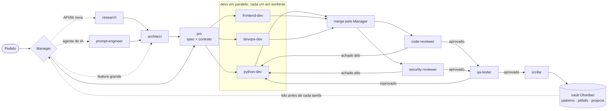

# ia-team-template

Template de um time de agentes de IA para o [Claude Code](https://docs.claude.com/en/docs/claude-code): 12 subagentes especializados, um Manager que orquestra o pipeline e uma memória persistente em Markdown (vault Obsidian) que o time lê antes de trabalhar e atualiza ao terminar cada feature.

> Versão pública e saneada do time que uso no dia a dia para desenvolver produtos com IA. Sem dados de clientes, caminhos pessoais ou credenciais.

## O que é

Cada papel é um arquivo em `.claude/agents/` com frontmatter (`name`, `description`, `tools`, `model`, `effort`) e um prompt que define responsabilidade, o que ler antes de agir, fronteiras de pasta e um **report obrigatório** em `coordination/`. O Manager (a sessão principal, instruída por `CLAUDE.md`) despacha os agentes, confere os reports e decide o próximo passo.

## Papéis

| Agente | Papel | Escreve |
|---|---|---|
| `research` | Discovery de API, modelo ou lib nova, com teste empírico | pattern no vault + `research-report.md` |
| `prompt-engineer` | Estrutura de system prompt, tool-calling, eval com POC | `prompt-strategy-<slug>.md` |
| `architect` | Decisões estruturais e de stack, sempre com 2+ opções e custo | `adr-<slug>.md` |
| `pm` | Spec com critérios de aceite binários e contrato de API | `spec.md`, `api-contract.yaml`, `types.ts` |
| `python-dev` | Serviços Python, workers, jobs | código + report |
| `frontend-dev` | UI React/Next.js, validada no Playwright, build verde obrigatório | código + report |
| `devops-dev` | Docker, CI, config de plataforma e env | infra + report |
| `conversation-designer` | Voz de chatbots de atendimento, diagnóstico de comportamento em produção | prompts + cenários de eval |
| `code-reviewer` | Qualidade, duplicação, contract drift (read-only) | `code-review-report.md` |
| `security-reviewer` | OWASP, segredos, deps, riscos específicos de LLM (read-only) | `security-review-report.md` |
| `qa-tester` | Critérios de aceite, edge cases, regressão, screenshots como evidência | `qa-report.md` |
| `scribe` | Post-mortem, patterns e pitfalls no vault | arquivos no vault |

## Fluxo



Pontos de projeto que fazem o fluxo funcionar:

- **Contrato imutável na implementação.** `api-contract.yaml` e `types.ts` são a lei; dev que precisa mudar volta ao PM. Isso permite front e back em paralelo sem divergir.
- **Worktrees isolados.** Cada dev trabalha numa cópia própria do repositório; o Manager faz o merge.
- **Inbox assíncrono.** Dúvidas entre agentes viram arquivos em `coordination/inbox/` em vez de bloquear o trabalho.
- **Report com gate.** Sem o arquivo de report no disco, o retorno do agente é rejeitado.
- **Cobertura antes de curadoria.** Reviewers e QA reportam todo achado com severidade e confiança separadas; o Manager filtra.

## Memória persistente

O vault (`vault-template/`) é uma pasta de Markdown que funciona como memória de longo prazo do time:

- `patterns/`: como usar um framework ou resolver um problema, com `verified-against-version`.
- `pitfalls/`: armadilhas com sintoma, causa raiz e como detectar.
- `projects/<projeto>/`: post-mortem de cada feature, com métricas (ciclos, bugs, red flags).

Todo agente lê o índice antes de agir. Quando falta conhecimento, segue o **protocolo de gap de memória**: pesquisa na doc oficial, grava o pattern no vault e só então implementa. O `scribe` consolida tudo ao fim de cada feature. Gravar direto no filesystem (e não por plugin do Obsidian) deixa o vault funcionando com o app fechado.

## Como usar

1. Copie `.claude/agents/`, `CLAUDE.md` e `coordination/` para a raiz do seu projeto (ou `.claude/agents/` para `~/.claude/agents/` para ter o time em todos os projetos).
2. Copie `vault-template/` para o seu vault Obsidian e troque `<VAULT>` nos prompts pelo caminho real.
3. Abra o Claude Code no projeto e peça a feature. O Manager segue o pipeline do `CLAUDE.md`; você também pode chamar um agente direto (`@pm especifique ...`).
4. Ajuste `model` e `effort` no frontmatter conforme custo e dificuldade; os prompts apontam para `patterns/claude-5-model-guide.md` no vault em vez de repetir números de modelo.

Opcional: um grafo do código em `graphify-out/` (os agentes consultam antes de ler arquivos brutos) e MCPs de Playwright e Supabase, que alguns agentes já listam em `tools`.

## Estrutura

```
.claude/agents/        12 subagentes
CLAUDE.md              instruções do Manager (pipeline e regras)
coordination/          README, template de report e protocolo do inbox
vault-template/        esqueleto do vault de memória
```

## English

A Claude Code template for a 12-role AI agent team (architect, PM, parallel devs in git worktrees, code and security review, QA, scribe).
A Manager session orchestrates the pipeline through file-based reports and an async inbox, with an immutable API contract during implementation.
Long-term memory lives in an Obsidian vault of patterns, pitfalls and per-feature post-mortems that every agent reads before acting.
